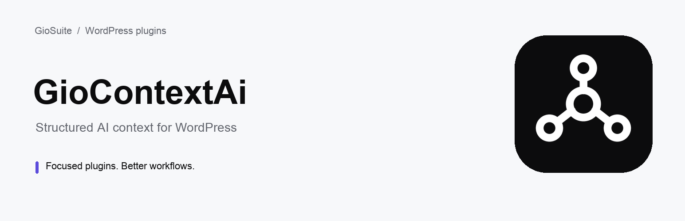

<p align="center">
  
</p>

<h1 align="center">GioContextAi</h1>

<p align="center">
  Generate <code>llms.txt</code>, <code>llms-full.txt</code> and <code>ai.txt</code> for WordPress, so AI crawlers and LLMs understand your site.
</p>

<p align="center">
  <a href="https://wordpress.org/plugins/giocontextai/"></a>
  <a href="https://wordpress.org/plugins/giocontextai/"></a>
  <a href="https://wordpress.org/plugins/giocontextai/"></a>
  
  <a href="https://github.com/GiovanniBevacqua/giocontextai/actions/workflows/php-lint.yml"></a>
  <a href="LICENSE"></a>
</p>

---

## About

AI assistants and search engines such as ChatGPT, Claude, Perplexity and Gemini increasingly read websites through
machine-readable context files. **GioContextAi** generates those files for your WordPress site automatically, from your
published content, with no physical files to maintain.

| Endpoint | Content |
| --- | --- |
| `/llms.txt` | A Markdown index of your selected content, following the [llms.txt proposal](https://llmstxt.org/) |
| `/llms-full.txt` | The same index plus the full plain-text content of every resource |
| `/ai.txt` | AI crawler directives and the sitemap location |
| `/products.json` | A machine-readable WooCommerce product feed (requires WooCommerce) |

## Features

- **Virtual endpoints** — served through WordPress rewrite rules; nothing is written to disk.
- **Post type selection** — choose which public post types are included.
- **Respects `noindex`** — content marked `noindex` in Yoast SEO, Rank Math or SEOPress is left out automatically.
- **Safe by default** — only published content; password-protected posts and WooCommerce/privacy system pages are excluded.
- **Per-post opt-out** — exclude any single post or page from the AI context files.
- **Clean output** — plain text without HTML tags or entities, served directly with `200 OK` (no redirects).
- **Fast** — output is cached and refreshed automatically when content changes; large sites are processed in batches.

## Requirements

- WordPress 6.0 or later
- PHP 7.4 or later
- Pretty permalinks enabled (any structure other than *Plain*)
- WooCommerce, only for `/products.json`

## Installation

**From WordPress.org (recommended)**

1. In your WordPress admin, go to **Plugins → Add New** and search for **GioContextAi**.
2. Click **Install Now**, then **Activate**.
3. Open **GioContextAi** in the admin menu and choose the post types to include.

**From GitHub**

Download the latest zip from the [Releases](https://github.com/GiovanniBevacqua/giocontextai/releases) page and upload it from
**Plugins → Add New → Upload Plugin**, or clone the repository into `wp-content/plugins/`:

```bash
git clone https://github.com/GiovanniBevacqua/giocontextai.git wp-content/plugins/giocontextai
```

After activation, visit `https://your-site.com/llms.txt` to see the generated file.

> If an endpoint returns a 404, go to **Settings → Permalinks** and click **Save Changes** to refresh the rewrite rules.

## Example output

```markdown
# Your Site Name
> Your site tagline

## Resources
- [About us](https://your-site.com/about/)
- [How to choose the right product](https://your-site.com/blog/how-to-choose/)
- [Contact](https://your-site.com/contact/)
```

## For developers

GioContextAi exposes hooks to customize the generated files.

| Hook | Type | Description |
| --- | --- | --- |
| `giocontextai_before_resources` | filter | Content added after the site header, before the `## Resources` section. |
| `giocontextai_post_item_output` | filter | The Markdown line of a single resource. Return an empty string to skip the resource. |
| `giocontextai_meta_box_after_exclude` | action | Runs inside the post meta box, after the exclusion checkbox. |
| `giocontextai_settings_tabs` / `giocontextai_settings_tab_content` | action | Add tabs and tab content to the settings page. |

```php
// Add a short "About" section to llms.txt.
add_filter( 'giocontextai_before_resources', function ( $output ) {
    return $output . "## About\nFamily-run shop of vintage stamps and coins since 1985.\n\n";
} );

// Append the publication date to every post in llms.txt.
add_filter( 'giocontextai_post_item_output', function ( $line, $post_id ) {
    return $line . ' (' . get_the_date( 'Y-m-d', $post_id ) . ')';
}, 10, 2 );
```

## GioContextAi Pro

[GioContextAi Pro](https://giosuite.com/giocontextai) extends the free plugin with Brand Voice and global AI instructions,
taxonomies and categories in `llms.txt`, per-content AI notes, a customizable and paginated product feed,
AI crawler analytics and an AI Readiness audit. The Pro add-on is distributed separately and is not part of this repository.

## Contributing

Contributions are welcome! Please read [CONTRIBUTING.md](CONTRIBUTING.md) before opening an issue or a pull request.
For usage questions, use the [WordPress.org support forum](https://wordpress.org/support/plugin/giocontextai/).

To report a security vulnerability, please follow [SECURITY.md](SECURITY.md) and **do not** open a public issue.

## Changelog

See [CHANGELOG.md](CHANGELOG.md).

## License

GioContextAi is free software, released under the [GNU General Public License v2.0 or later](LICENSE).

Made by [Giovanni Bevacqua](https://www.linkedin.com/in/giovanni-bevacqua/) · [giosuite.com](https://giosuite.com)
